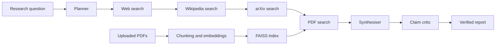

# SentinelRAG

SentinelRAG is a multi-source research assistant that combines retrieval-augmented generation, citation provenance, and claim-level verification. A user submits a research question, the system retrieves evidence from external and local sources, generates a cited answer, and checks the generated claims against the retrieved evidence.

The project is designed to make LLM-generated research easier to inspect. It does not train or fine-tune a language model; it orchestrates search APIs, a hosted LLM, local PDF embeddings, and a natural-language-inference model.

## Features

- Query planning with automatic decomposition into focused sub-questions.
- Optional retrieval from Tavily web search, Wikipedia, arXiv, and uploaded PDF documents.
- Local PDF indexing with Sentence Transformers embeddings and FAISS similarity search.
- Cited answer generation with source identifiers such as `[WEB1]`, `[WIKI1]`, `[ARXIV1]`, and `[PDF1]`.
- Sentence-level claim verification using `cross-encoder/nli-deberta-v3-small`.
- Verification verdicts including verified, uncertain, contradicted, uncited, and source not found.
- Detection and reporting of conflicts between supporting and contradicting sources.
- Faithfulness score based on the proportion of claims classified as entailed.
- Gradio interface with a research workflow and a standalone claim-verifier workflow.
- Graceful fallbacks when a source is disabled, unavailable, or returns no results.

## Architecture



### Pipeline stages

1. **Planner**: Uses Groq to convert the original question into three to five sub-questions.
2. **Retrieval**: Each enabled source node searches using those sub-questions. Results are normalized into a common source format.
3. **PDF indexing**: Uploaded PDFs are text-extracted, split into overlapping chunks, embedded, and stored in a FAISS inner-product index.
4. **Synthesis**: Groq receives the retrieved context and is instructed to answer only from that context with inline citations.
5. **Verification**: The critic splits the draft into sentences, resolves cited source IDs, and runs NLI classification against the cited evidence.
6. **Reporting**: The UI displays the answer, faithfulness score, claim matrix, detected conflicts, and source details.

The graph is assembled with LangGraph in [sentinelrag/graph.py](sentinelrag/graph.py). Retrieval nodes live under [sentinelrag/nodes](sentinelrag/nodes), PDF processing is implemented in [sentinelrag/pdf_processor.py](sentinelrag/pdf_processor.py), and the Gradio application is defined in [app.py](app.py).

## Technology Stack

- **Python 3.12+**
- **LangGraph** for stateful workflow orchestration
- **Groq** for query planning and answer synthesis
- **Tavily** for web retrieval
- **Wikipedia** and **arXiv** APIs for reference retrieval
- **Sentence Transformers** for PDF embeddings and NLI verification
- **FAISS** for local vector similarity search
- **PyMuPDF** for PDF text extraction
- **NLTK** for sentence tokenization
- **Gradio** for the web interface

## Requirements

- Python 3.12 or newer
- A Groq API key
- A Tavily API key if web search is enabled
- Internet access for Groq, Tavily, Wikipedia, arXiv, and model downloads
- Enough local disk space for Sentence Transformer and NLI model caches

## Installation

```powershell
git clone <your-repository-url>
cd SentinelRAG
python -m venv .venv
.\.venv\Scripts\Activate.ps1
python -m pip install --upgrade pip
pip install -r requirements.txt
```

On macOS or Linux, activate the environment with:

```bash
source .venv/bin/activate
```

## Configuration

Create a `.env` file in the project root:

```env
GROQ_API_KEY=your_groq_api_key
TAVILY_API_KEY=your_tavily_api_key
```

`GROQ_API_KEY` is used for planning and answer synthesis. `TAVILY_API_KEY` is only required when Web Search is selected. Do not commit `.env` or expose API keys in screenshots or public repositories.

## Running the Application

```powershell
python app.py
```

Open [http://localhost:7860](http://localhost:7860) in a browser.

### Research Agent tab

1. Enter a research question.
2. Select one or more source types.
3. Optionally upload one or more PDF files.
4. Select **Generate Research Report**.
5. Review the generated answer, citations, verification matrix, conflicts, and source details.

### Claim Verifier tab

Paste a source passage and a claim to receive an NLI-based verdict and the strongest matching evidence sentence. The first use may take longer while the cross-encoder model is downloaded and loaded.

## Project Structure

```text
.
├── app.py                         # Gradio application and UI handlers
├── requirements.txt               # Python dependencies
└── sentinelrag/
	├── graph.py                   # LangGraph assembly and run_query()
	├── pdf_processor.py           # PDF extraction, chunking, and FAISS search
	├── state.py                   # Typed graph state and initial state factory
	├── utils.py                   # Citation, parsing, and text utilities
	└── nodes/
		├── planner.py             # Query decomposition
		├── web_search.py          # Tavily retrieval
		├── wiki_search.py         # Wikipedia retrieval
		├── arxiv_search.py        # arXiv retrieval
		├── pdf_search.py          # PDF knowledge-base retrieval
		├── synthesiser.py         # Cited answer generation
		└── critic.py              # NLI claim verification
```

## Programmatic Usage

The graph can also be called without the Gradio interface:

```python
from sentinelrag.graph import run_query

result = run_query(
	question="How does retrieval-augmented generation work?",
	active_sources=["web", "wikipedia", "arxiv"],
)

print(result["final_answer"])
print(result["faithfulness_score"])
```

Supported source names are `web`, `wikipedia`, `arxiv`, and `pdf`.

## Validation

Run the syntax check:

```powershell
python -m compileall -q app.py sentinelrag
```

Run a no-network pipeline smoke test:

```powershell
python -c "from sentinelrag.graph import run_query; result=run_query('smoke test', active_sources=[]); print(bool(result.get('final_answer')))"
```

## Limitations

- Search quality and availability depend on third-party APIs and network access.
- The faithfulness score is an NLI-based heuristic, not a guarantee that an answer is factually correct.
- NLI model downloads and PDF embedding generation can be resource-intensive on first use.
- Source retrieval currently runs through the graph nodes in sequence.
- Wikipedia, arXiv, and Tavily may impose rate limits or return incomplete results.
- There is no benchmark suite or production-grade evaluation dataset included in the repository.

## Resume-Ready Description

**SentinelRAG | Multi-Source Research and Claim Verification System**

- Built a LangGraph-based RAG pipeline that decomposes research questions, retrieves evidence from web, Wikipedia, arXiv, and uploaded PDFs, and generates citation-grounded answers with Groq.
- Implemented local PDF semantic search using Sentence Transformers, overlapping text chunking, and FAISS inner-product indexing.
- Added sentence-level provenance verification with an NLI cross-encoder, including faithfulness scoring, uncited/source-not-found detection, and cross-source conflict reporting.
- Developed a Gradio interface with source selection, multi-file PDF upload, claim verification, evidence previews, and verification tables.

## License

No license file is currently included. Add a license before distributing the project publicly.
